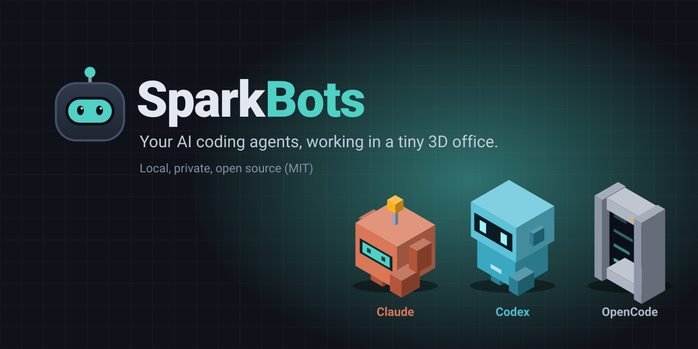
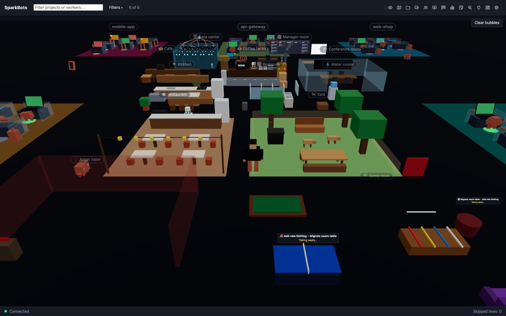

<p align="center">
  
</p>

# SparkBots

**Your AI coding agents, working in a tiny 3D office. Everything stays on your machine.**

SparkBots turns the session history of your coding agents into a small low-poly campus you can walk around. Every **Claude Code**, **Codex** and **OpenCode** session is a robot at a desk, every project is a team area. You see at a glance who is working, who is waiting for you, and who is asleep, and you can walk up to a desk (or open a chat panel) and talk to that agent.

It is a personal tool first: local, private, a bit silly on purpose, and careful with anything that touches your sessions.

> Original mascot and artwork. SparkBots is not affiliated with Anthropic, OpenAI or the OpenCode project; their tools are only named as things SparkBots can read.

---

<p align="center">
  
</p>

## Why

If you run several agents across several projects, the terminal gives you tabs and scrollback, not awareness. Which one is blocked on a permission prompt? Which project burned the tokens this week? What was that agent doing yesterday? SparkBots answers those at a glance, and makes the answers pleasant to look at.

## What you get

**See everything**
- A 3D campus: one area per project, one robot per session, sleeping robots for history, glowing ones for live work. A 100-worker view stays smooth (instanced meshes); test it with `&fixture=100`.
- Status colours and bubbles: working, waiting for you (amber beacon), error, done (a wave), idle, asleep.
- Every room is also a normal 2D panel (Teams, Control room, Stats, Board, Server room, Settings), so walking is never required.

**Talk to your agents, carefully**
- Chat with any session from a side panel; replies stream in live. Continue, fork, or hire a new robot in a project.
- Safety rails built in: a session open in a terminal is never written to (fork instead), one run per session at a time, queued messages, a Stop button that only stops what SparkBots started, and `--dangerously-skip-permissions` is never used. A denied tool can be allowed for one retry, with a click.
- Send a **kanban card** to an agent, a fork, or a new robot. Cards move to Review when the run ends; Done is always manual. A read-only **Backlog.md** lane shows your project's backlog next to the cards.

**Understand usage**
- Stats by day, project, model and **service** (Claude Code / Codex / OpenCode), with 7/30/90-day views and an estimated cost (clearly labelled as an estimate).
- History is stored in SparkBots' own SQLite file, so it outlives the tools' transcript clean-up: analytics forever, locally.
- A **Data center**: one rack per project, with LEDs that blink faster the busier the project is, tape reels, cables and inspector robots. Click the console to search everything your agents ever said.

**Have a little fun** (cosmetic, never touching agent work)
- A coffee factory with a barista robot (press `O`), a game room where idle agents pair up for pong, air hockey, rock-paper-scissors and dice (with rankings), a gym, a restaurant, an anger room, and a sponsor room.
- Walk as an avatar or float a big hand around; *Perform* zap, dance or high-five an agent; call a meeting with a crowd of followers; a "Boss is coming" key for when you want the office to look busy.
- A simulated water-cooler chat for idle agents: fully offline, written in advance, no model calls.

## Quick start

**Pull the repo, run one script, enjoy:**

```bash
git clone https://github.com/rapttor/sparkbots.git
cd sparkbots
./install.sh          # Windows: powershell -ExecutionPolicy Bypass -File .\install.ps1
```

The script checks Node (22.13+, Node 24 recommended) and pnpm and installs them if they are missing (it asks first, and only with Homebrew or nvm; otherwise it tells you what to install), installs the dependencies, builds, starts SparkBots and opens the page in your browser. Everything stays inside the repository folder; it never touches `~/.claude` or your agents' files. Useful options: `--no-open` (just print the address), `--dev` (watch mode with hot reload), `--skip-build`, `--install-only`, `--check` (report only, change nothing), `--yes` (do not ask). Read `install.sh` first if you like: it is short.

By hand, the same thing is:

```bash
pnpm install
pnpm build
pnpm start --open     # prints http://127.0.0.1:4317/?t=<token>
```

| Command | What it does |
|---|---|
| `pnpm start` | Start the server (serves the built client). Add `--open` to open the browser. |
| `pnpm open` | Same as `pnpm start --open`. |
| `pnpm monitor` / `pnpm dev` | Watch mode: the server restarts on code changes, the client hot-reloads. Uses a persisted token (`~/.agent-office/dev-token`, mode 0600) so an open tab survives restarts. `--no-open` skips the browser. In the terminal, press `o` to open the page again (if you closed the browser) and `q` to quit. |
| `pnpm test` | Run the test suite (Vitest). |
| `pnpm typecheck` | TypeScript, strict. |

Try it without any history: add `&fixture=40` (any number) to the URL to fill the office with fake workers.

## Controls

| Key / mouse | What it does |
|---|---|
| `W A S D` / arrows, `Shift` | Move (hold Shift to sprint). In hand mode: A/D turn, W/S zoom. |
| Click floor | Avatar: walk there. Hand: the camera glides there; hold and drag to pan. |
| Click an agent | Open its menu: talk, follow, fork, perform, send somewhere, give a card. |
| `E` | Talk to the nearby agent, or use the data console. |
| `C` / `0` | Camera behind you / reset the view. |
| Scroll, right-drag | Zoom (in = first person, out = overview) and turn. |
| `M`, `L`, `T` | Map tab, lock zoom, name tags. |
| `O`, `R`, `U`, `I` | Order a coffee, rally the waiting agents, "boss is coming", lunch break. |
| `Q`, `X`, `Shift+click` | Meeting chat, release the followers, add/remove a follower. |

Everything above is also clickable in the in-app Keymap (Settings).

## Supported agents

| Agent | Reads | Talks to it | Notes |
|---|---|---|---|
| Claude Code | `~/.claude/projects/` | `claude -p --resume <id>` | Optional hooks make state exact. |
| Codex | `~/.codex/sessions/` | Codex queue | Archived `.zst` sessions load on demand. |
| OpenCode | its SQLite DB (read-only), mirrored to a cache | `opencode run --session <id>` | Stop and run registry supported. |

Other local AI servers (Ollama, LM Studio, llama.cpp, ...) show up as *services* with status and loaded models, not as workers.

## Privacy

**Nothing leaves your machine.** The server binds to `127.0.0.1` only, requires a random token on every request, rejects foreign `Host`/`Origin` headers, makes no external requests and sends no telemetry. It only **reads** `~/.claude/`, `~/.codex/` and the local OpenCode database; its own files live in `~/.agent-office/` (the folder name is kept for compatibility). Message previews and speech bubbles can be turned off (`streamingMode` in `config.json`) for screen sharing.

## Safety

- Prompts reach `claude`, Codex or OpenCode as argv entries, never through a shell.
- A session open in an interactive terminal cannot be written to; fork it instead.
- One run per session at a time; extra messages are queued.
- `bypassPermissions` and `--dangerously-skip-permissions` are never used. Permission overrides per project are explicit and visible.
- Stop only signals processes SparkBots itself spawned.

## How it works (short)

Per-agent **adapters** discover sessions, tail the transcripts incrementally (byte offsets, never whole-file re-reads), and turn records into events: tool use, turns, usage, permission waits, sub-agents. A small **state machine** derives each worker's state from the live process plus recent activity. The server pushes **incremental patches** over a WebSocket (a rev-numbered diff protocol, see `docs/SYNC.md`), and the React Three Fiber client renders bots, desks and rooms as instanced meshes. Rooms, actions, effects and clips are **data files** picked up automatically, so adding one is a single small file.

```
server/   Fastify + ws + chokidar: adapters (claude-code, codex, opencode), model, stats, board, services, SQLite (app.db)
src/      React + three/R3F + zustand: world (3D), panels (2D), dock, state
docs/     TASKS.md (the plan), CHANGELOG.md, SYNC.md
presskit/ articles and artwork
```

## Config (`~/.agent-office/`)

`config.json` (port, thresholds, history window, streaming mode), `teams.json` (directory globs to team merges, colours, per-team `allowedTools` / `permissionMode`), `board.json`, `runs.json`, and `app.db` (SQLite: usage history, rack aliases, caffeine, game results, rewards).

## Optional hooks (more precise state)

```bash
pnpm start hooks install     # shows a diff, asks to confirm, backs up settings.json first
pnpm start hooks uninstall   # removes exactly the entries it added
```

Adds `curl` hooks (SessionStart, UserPromptSubmit, PreToolUse, Notification, Stop, SubagentStop, SessionEnd) to `~/.claude/settings.json` that POST to `127.0.0.1` with a separate stable token (`~/.agent-office/hook-token`, mode 0600). Backups go to `~/.agent-office/backups/`. The app works fully without hooks; without them, state lags by up to about 15 seconds.

## Good to know

- The on-disk formats of Claude Code, Codex and OpenCode are **not public APIs**. The parsers are defensive: unknown or corrupt lines are skipped and counted, and nothing crashes the server.
- Cost figures are **estimates** from `server/stats/prices.json` (Claude prices only; other services show tokens). Subscription limits are not in local files, so SparkBots does not pretend to know them.
- It is a local single-user tool. There is no hosted version and no account.

## Roadmap

The plan lives in [`docs/TASKS.md`](docs/TASKS.md), tagged by effort. Open items include live permission approval in chat, slash commands, billiards, basketball, the claw machine and the race track, project cubicles, and optional opt-in sync. Ideas are welcome as issues.

## Contributing

Issues and pull requests are welcome. Read [`CLAUDE.md`](CLAUDE.md) first: it holds the ground rules (read-only on agent data, no permission bypass, original mascot only, localhost only). Run `pnpm typecheck && pnpm test` before opening a PR. New rooms, actions and effects are single files under `src/world/zones`, `actions` and `fx`.

## Support the project

SparkBots is free and MIT licensed. If it saves you time or makes you smile:

- Patreon: https://www.patreon.com/c/rapttor
- Buy me a coffee: https://buymeacoffee.com/rapttor
- Ethereum (ETH, mainnet only): `0xeF4590e1c22Cabade5300aFa469f9dDEBA1275D2`
- GitHub Sponsors: not set up yet (github.com/rapttor)

A star on the repository, a bug report, or telling another person who runs too many agents helps just as much.

## Licence

Code: MIT. Artwork in `presskit/`: CC BY 4.0 unless a file says otherwise. The bot mascot is an original design.
